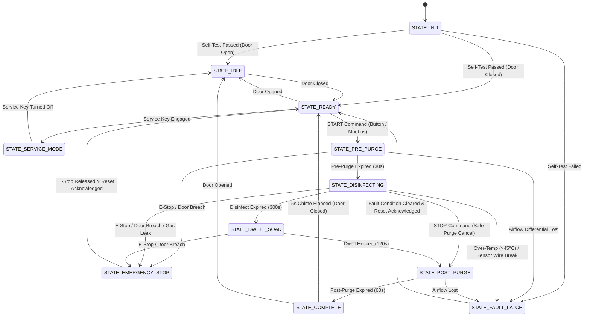

# Smart Industrial Disinfection & Environment Monitoring Controller

[](https://github.com/Sherifred123/smart-industrial-disinfection-controller/actions)
[-00599C?style=for-the-badge&logo=c&logoColor=white)](https://en.wikipedia.org/wiki/C_(programming_language))
[](https://www.st.com)
[](https://en.wikipedia.org/wiki/Modbus)
[](LICENSE)

> **Production-grade, modular, event-driven embedded firmware for industrial sterilization chambers, cleanroom decontamination units, and environmental safety monitors.**

Designed from the ground up with a strict **4-layer architecture** (HAL $\rightarrow$ Drivers $\rightarrow$ Middleware/Services $\rightarrow$ Application), non-blocking multi-rate scheduling, **CRC-16** protected non-volatile configuration storage, dual-stage digital filtering, and a full **Modbus RTU Slave stack over RS-485**.

---

## 📑 Table of Contents

- [1. System Overview & Problem Statement](#1-system-overview--problem-statement)
- [2. Key Technical Features](#2-key-technical-features)
- [3. System Architecture](#3-system-architecture)
- [4. Process Finite State Machine (FSM)](#4-process-finite-state-machine-fsm)
- [5. Hardware Pinout & Block Diagram](#5-hardware-pinout--block-diagram)
- [6. Modbus RTU Register Specification](#6-modbus-rtu-register-specification)
- [7. NVM Configuration & Checksum Engine](#7-nvm-configuration--checksum-engine)
- [8. Signal Processing & Digital Filtering](#8-signal-processing--digital-filtering)
- [9. Safety Supervisor & Fault Matrix](#9-safety-supervisor--fault-matrix)
- [10. Automated Testing & Verification](#10-automated-testing--verification)
- [11. Quickstart & Interactive Simulation CLI](#11-quickstart--interactive-simulation-cli)
- [12. Architectural Decision: Cooperative vs FreeRTOS](#12-architectural-decision-cooperative-vs-freertos)
- [13. Connect With Me](#13-connect-with-me)

---

## 1. System Overview & Problem Statement

Industrial decontamination enclosures (e.g., VHP, UV-C radiation, chemical aerosol sterilizers) require deterministic, fail-safe automation to guarantee:
1. **Human Operator Safety:** Preventing chemical exposure by locking access doors during active cycles and executing immediate ($<10\,\mu\text{s}$) actuator de-energization if an emergency stop or door breach occurs.
2. **Atmospheric Clearance Assurance:** Enforcing strict pre-purge and post-purge scrubber cycles to verify gas concentrations fall below OSHA limits before unlocking.
3. **Recipe Configuration & SCADA Telemetry:** Enabling plant PLCs to adjust cycle recipes, monitor real-time chamber telemetry, and capture audit alarms via RS-485 Modbus RTU.
4. **NVM Data Integrity:** Guaranteeing that setpoints persisted in Flash/EEPROM cannot be corrupted by power fluctuations or memory wear.

> [!NOTE]
> **Educational Notice:** This repository is an independent portfolio implementation demonstrating senior-level embedded firmware design patterns. It controls simulated actuators and relays and is not intended for direct deployment on live hazardous chemical equipment without certified hardware interlocking.

---

## 2. Key Technical Features

- **Strict 4-Layer Architecture:** Complete physical decoupling across Hardware Abstraction Layer (HAL), Device Drivers, Application Services, and Application Logic.
- **Deterministic Multi-Rate Scheduler:** Non-blocking time-sliced super-loop executing 1ms, 10ms, 100ms, and 1000ms periodic tasks with zero delay loops (`while(1)` polling forbidden).
- **12-State Event-Driven FSM:** Robust state transitions covering initialization, pre-purge, active disinfection, soak dwell, post-purge ventilation, completion, warnings, critical latches, and service modes.
- **Dual-Stage Signal Conditioning:** Median-3 filter for transient spike rejection cascaded into an integer Q8 fixed-point Exponential Moving Average (EMA) filter.
- **Modbus RTU Slave over RS-485:** Full support for standard function codes `0x01` (Read Coils), `0x02` (Read Discrete Inputs), `0x03` (Read Holding Regs), `0x04` (Read Input Regs), `0x05` (Write Coil), `0x06` (Write Reg), and `0x10` (Write Multiple Regs) with 3.5-character silence detection.
- **Robust NVM Parameter Store:** Configuration struct with Magic ID (`0x53494443`), schema versioning, and **CRC-16-CCITT** integrity check with automatic fallback to factory defaults.
- **Circular Event Logger:** In-memory timestamped circular audit log capturing the last 64 system state transitions, faults, and operator commands.
- **Automated Test Suite (100% Pass Rate):** 10 automated test suites covering unit algorithms, multi-module integration, and full-cycle deterministic time-travel system tests in CI/CD.
- **Interactive Terminal Simulator:** ANSI-colored real-time CLI dashboard allowing live cycle execution, sensor fault injection, and Modbus frame testing on any PC.

---

## 3. System Architecture

```mermaid
graph TD
    subgraph APPLICATION_LAYER["Application Layer (firmware/app/)"]
        MAIN["app_main.c <br> (Deterministic Multi-Rate Scheduler)"]
        FSM["app_fsm.c <br> (12-State Process FSM)"]
        CTRL["process_controller.c <br> (Process Coordinator & Safety Rules)"]
    end

    subgraph SERVICES_LAYER["Middleware & Services Layer (firmware/services/)"]
        CONFIG["config_manager.c <br> (NVM Parameter Store + CRC16)"]
        ALARM["alarm_fault_manager.c <br> (Fault Latches & Beacon Driver)"]
        MODBUS["modbus_rtu_slave.c <br> (Modbus RTU Protocol Stack)"]
        FILTER["filter_service.c <br> (Fixed-Point EMA & Median-3 Filters)"]
        LOGGER["event_logger.c <br> (Circular Timestamped Audit Log)"]
        RING["ring_buffer.c <br> (Lock-Free SPSC Byte Queue)"]
        CRC["crc16.c <br> (CCITT & Modbus CRC Engines)"]
    end

    subgraph DRIVERS_LAYER["Device Drivers Layer (firmware/drivers/)"]
        SENS_DRV["sensor_driver.c <br> (Multi-Channel Scaler & Debouncer)"]
        ACT_DRV["actuator_driver.c <br> (Relays, Solenoid Lock, Beacons)"]
        NVM_DRV["nvm_driver.c <br> (Sector Read / Write / Erase Driver)"]
    end

    subgraph HAL_LAYER["Hardware Abstraction Layer (firmware/hal/ & port/)"]
        HAL_GPIO["hal_gpio.h <br> [stm32 / host_sim]"]
        HAL_TIMER["hal_timer.h <br> [stm32 / host_sim]"]
        HAL_ADC["hal_adc.h <br> [stm32 / host_sim]"]
        HAL_UART["hal_uart.h <br> [stm32 / host_sim]"]
        HAL_NVM["hal_nvm.h <br> [stm32 / host_sim]"]
        HAL_WDT["hal_watchdog.h <br> [stm32 / host_sim]"]
    end

    APPLICATION_LAYER --> SERVICES_LAYER
    SERVICES_LAYER --> DRIVERS_LAYER
    DRIVERS_LAYER --> HAL_LAYER
```



---

## 4. Process Finite State Machine (FSM)



---

## 5. Hardware Pinout & Block Diagram

```mermaid
graph TD
    subgraph SENSORS["Analog & Digital Sensor Inputs"]
        TEMP["Chamber Temp Sensor (0-3.3V)"] -->|ADC1_IN0| MCU["STM32F401 / Cortex-M4 MCU"]
        HUM["Humidity Sensor (0-3.3V)"] -->|ADC1_IN1| MCU
        GAS["Process Concentration (0-3.3V)"] -->|ADC1_IN2| MCU
        LEAK["Ambient Safety Leak Sensor"] -->|ADC1_IN3| MCU
        ESTOP["Emergency Stop (NC Contact)"] -->|GPIOB_PIN1| MCU
        DOOR["Safety Door Interlock"] -->|GPIOB_PIN2| MCU
        FLOW["Exhaust Airflow Diff Switch"] -->|GPIOB_PIN11| MCU
        START_SW["Cycle Start Pushbutton"] -->|GPIOC_PIN13| MCU
        STOP_SW["Cycle Stop Pushbutton"] -->|GPIOB_PIN0| MCU
    end

    subgraph ACTUATORS["Opto-Isolated Actuators & Relays"]
        MCU -->|GPIOA_PIN8| RELAY_DISINFECT["Disinfection Relay / Valve"]
        MCU -->|GPIOA_PIN9| RELAY_EXHAUST["Exhaust Scrubber Fan"]
        MCU -->|GPIOA_PIN10| SOLENOID_DOOR["Door Lock Solenoid"]
        MCU -->|GPIOA_PIN5| LED_GRN["Green Beacon (Ready)"]
        MCU -->|GPIOA_PIN6| LED_YEL["Yellow Beacon (Active)"]
        MCU -->|GPIOA_PIN7| LED_RED["Red Beacon (Fault)"]
        MCU -->|GPIOB_PIN6| BUZZER["Audible Alarm Buzzer"]
    end

    subgraph COMM_STORAGE["Communication & Supervisory"]
        MCU <-->|USART1 + DE Pin| RS485["MAX485 Transceiver (Modbus RTU)"]
        MCU <-->|Internal Flash| NVM["NVM Configuration Block (CRC16)"]
        MCU -->|IWDG| WATCHDOG["Hardware Independent Watchdog"]
    end
```



| Signal Name | Target Pin (STM32 Nucleo) | Peripheral Type | Description | Safe Default State |
| :--- | :--- | :--- | :--- | :--- |
| `HAL_GPIO_IN_START_BTN` | `PC13` | Digital Input (Pull-Up) | Cycle Start Pushbutton | High (Released) |
| `HAL_GPIO_IN_STOP_BTN` | `PB0` | Digital Input (Pull-Up) | Cycle Stop Pushbutton | High (Released) |
| `HAL_GPIO_IN_ESTOP_NC` | `PB1` | Digital Input (Pull-Up) | Emergency Stop (Normally Closed) | High (Normal / Closed) |
| `HAL_GPIO_IN_DOOR_INTERLOCK` | `PB2` | Digital Input (Pull-Up) | Door Magnetic Reed Switch | High (Closed) |
| `HAL_GPIO_IN_AIRFLOW_SW` | `PB11` | Digital Input (Pull-Up) | Differential Pressure Switch | High (Flow OK) |
| `HAL_GPIO_OUT_DISINFECT_RELAY`| `PA8` | Digital Output PP | Disinfection Actuator Relay | Low (De-energized) |
| `HAL_GPIO_OUT_EXHAUST_FAN` | `PA9` | Digital Output PP | Exhaust Scrubber Blower Fan | Low (De-energized) |
| `HAL_GPIO_OUT_DOOR_LOCK` | `PA10` | Digital Output PP | Solenoid Door Interlock Lock | Low (Unlocked) |
| `HAL_ADC_CH_CHAMBER_TEMP` | `PA0` | `ADC1_IN0` (0-3.3V) | Chamber Temperature Sensor | ~25.0 °C (~750 mV) |
| `HAL_ADC_CH_CHAMBER_HUMIDITY`| `PA4` | `ADC1_IN4` (0-3.3V) | Relative Humidity Sensor | ~50 %RH (~1650 mV) |
| `HAL_ADC_CH_PROCESS_CONC` | `PC0` | `ADC1_IN10` (0-3.3V) | Active Gas Concentration | 0 PPM (0 mV) |
| `HAL_ADC_CH_AMBIENT_SAFETY` | `PC1` | `ADC1_IN11` (0-3.3V) | Room Leak Detection Sensor | 0 PPM (0 mV) |
| `HAL_UART_PORT_MODBUS` | `PA9 / PA10` | `USART1` (RS-485) | Modbus RTU Communication | 19200 Baud, 8-N-1 |

---

## 6. Modbus RTU Register Specification

### Telemetry Input Registers (Function Code `0x04` - Read Only)

| Address | Protocol Addr | Name | Units | Description / Scaling |
| :---: | :---: | :--- | :--- | :--- |
| `30001` | `0x0000` | System State | State ID | `0`=Init, `1`=Idle, `2`=Ready, `4`=Disinfect... |
| `30002` | `0x0001` | Chamber Temperature | $0.1\,^\circ\text{C}$ | `254` = $25.4\,^\circ\text{C}$ |
| `30003` | `0x0002` | Chamber Relative Humidity | $\% \text{RH}$ | `0 - 100` $\% \text{RH}$ |
| `30004` | `0x0003` | Process Gas Concentration | $\text{PPM}$ | `0 - 200` $\text{PPM}$ |
| `30005` | `0x0004` | External Room Leak Sensor | $\text{PPM}$ | `0 - 50` $\text{PPM}$ |
| `30006` | `0x0005` | Phase Elapsed Time | Seconds | Integer seconds in active phase |
| `30007` | `0x0006` | Phase Remaining Time | Seconds | Integer countdown seconds |
| `30008` | `0x0007` | Active Fault Bitmask | Bitmask | Bit 0: E-Stop, Bit 1: Door, Bit 2: Temp... |

### Configuration Holding Registers (Function Codes `0x03`, `0x06`, `0x10` - Read/Write)

| Address | Protocol Addr | Parameter Name | Default | Safety Limit |
| :---: | :---: | :--- | :---: | :--- |
| `40001` | `0x0000` | Pre-Purge Duration | $30\,\text{s}$ | $5 - 600\,\text{s}$ |
| `40002` | `0x0001` | Disinfection Duration | $300\,\text{s}$ | $10 - 7200\,\text{s}$ |
| `40003` | `0x0002` | Dwell Soak Duration | $120\,\text{s}$ | $0 - 3600\,\text{s}$ |
| `40004` | `0x0003` | Post-Purge Duration | $60\,\text{s}$ | $10 - 1800\,\text{s}$ |
| `40005` | `0x0004` | Target Concentration | $50\,\text{PPM}$ | $10 - 150\,\text{PPM}$ |
| `40006` | `0x0005` | Max Chamber Temperature | $45\,^\circ\text{C}$ | $20 - 85\,^\circ\text{C}$ |
| `40007` | `0x0006` | External Leak Limit | $5\,\text{PPM}$ | $1 - 50\,\text{PPM}$ |
| `40008` | `0x0007` | Min Humidity Setpoint | $40\,\%\text{RH}$ | $10 - 90\,\%\text{RH}$ |
| `40009` | `0x0008` | Door Interlock Enforcement | `1` | `1` = Enforced, `0` = Bypassed |

---

## 7. NVM Configuration & Checksum Engine

```text
Offset  Field Name                  Type        Size   Description
---------------------------------------------------------------------------------------------
0x00    magic_word                  uint32_t    4 B    Fixed Magic ID: 0x53494443 ("SIDC")
0x04    schema_version              uint16_t    2 B    Format Version: 0x0100 (v1.0)
0x06    payload_len                 uint16_t    2 B    Total bytes of configuration
0x08    pre_purge_duration_s        uint16_t    2 B    Pre-purge duration (seconds)
0x0A    disinfect_duration_s        uint16_t    2 B    Disinfection duration (seconds)
0x0C    dwell_soak_duration_s       uint16_t    2 B    Dwell soak duration (seconds)
0x0E    post_purge_duration_s       uint16_t    2 B    Post-purge duration (seconds)
0x10    target_concentration_ppm    uint16_t    2 B    Target concentration setpoint
0x12    max_temperature_c           uint16_t    2 B    Max allowable chamber temp (°C)
0x14    ambient_leak_limit_ppm      uint16_t    2 B    Room leak trip threshold (PPM)
0x16    min_humidity_rh             uint16_t    2 B    Minimum humidity (% RH)
0x18    modbus_slave_id             uint8_t     1 B    Modbus Node Address (1 - 247)
0x19    modbus_baud_idx             uint8_t     1 B    Baud index (0:9600, 1:19200...)
0x1A    door_interlock_enable       uint8_t     1 B    Safety door enforcement flag
0x1B    auto_purge_on_fault         uint8_t     1 B    Run scrubber on emergency trip
0x1C    crc16                       uint16_t    2 B    CRC-16-CCITT Checksum over 0x00-0x1B
---------------------------------------------------------------------------------------------
Total Block Size: 30 Bytes
```

- **Integrity Validation:** Upon startup, the configuration manager recalculates the 16-bit CRC-CCITT over the entire parameter block. If a CRC mismatch or invalid parameter boundary is detected, it automatically restores factory defaults and writes a pristine block.

---

## 8. Signal Processing & Digital Filtering

To eliminate electrical contact bounce and switching noise without floating-point FPU penalties:

1. **Median-3 Filter:** Evaluates a rolling 3-sample window, instantly discarding transient voltage spikes caused by inductive relay and contactor switching.
2. **Fixed-Point Exponential Moving Average (EMA):**
   $$\text{State}[n] = \frac{\alpha \cdot \text{Sample}[n] + (256 - \alpha) \cdot \text{State}[n-1]}{256}$$
   Implemented with integer arithmetic ($\alpha = 20\% \approx 51/256$) to provide smooth, low-latency analog measurements.

---

## 9. Safety Supervisor & Fault Matrix

```text
Bit Position  Fault Name                       Severity    Automatic Action Taken
---------------------------------------------------------------------------------------------------------
Bit 0 (0x01)  FAULT_CODE_ESTOP_ACTIVE          CRITICAL    Immediate relay cut, auto-purge ON, red beacon
Bit 1 (0x02)  FAULT_CODE_DOOR_BREACH           CRITICAL    Immediate relay cut, enter EMERGENCY_STOP
Bit 2 (0x04)  FAULT_CODE_TEMP_OVER_LIMIT       CRITICAL    De-energize disinfection relay, enter FAULT_LATCH
Bit 3 (0x08)  FAULT_CODE_AMBIENT_GAS_LEAK      CRITICAL    Immediate shutoff, run exhaust scrubber fan
Bit 4 (0x10)  FAULT_CODE_AIRFLOW_LOST          CRITICAL    Abort pre-purge, latch exhaust blower fault
Bit 5 (0x20)  FAULT_CODE_PROCESS_TIMEOUT       WARNING     Log audit warning, initiate post-purge
Bit 6 (0x40)  FAULT_CODE_NVM_CORRUPTED         WARNING     Auto-restore factory defaults, log event
Bit 7 (0x80)  FAULT_CODE_COMM_TIMEOUT          WARNING     Blink yellow beacon, continue autonomous loop
Bit 8 (0x100) FAULT_CODE_SENSOR_DISCONNECTED   CRITICAL    Abort active cycle, transition to FAULT_LATCH
```

- **Hardware Latching:** Latched critical faults cannot be cleared while the physical emergency contact remains open. Calling reset verifies hardware circuit continuity before unlocking the controller.

---

## 10. Automated Testing & Verification

The repository includes a comprehensive 10-suite unit, integration, and system test harness:

```text
==============================================================
  SMART INDUSTRIAL DISINFECTION CONTROLLER FIRMWARE TEST SUITE
  Author: Sherifred Singh | Embedded Firmware Architecture
==============================================================

  SUITE: 01. SPSC Ring Buffer Unit Tests                      [PASS]
  SUITE: 02. CRC-16 Checksum Unit Tests (CCITT & Modbus)      [PASS]
  SUITE: 03. Digital Filter Service (EMA & Median-3)          [PASS]
  SUITE: 04. NVM Parameter Store & Corruption Recovery        [PASS]
  SUITE: 05. Alarm & Safety Fault Manager                     [PASS]
  SUITE: 06. Modbus RTU Slave Protocol Stack                  [PASS]
  SUITE: 07. Application State Machine (FSM) Engine           [PASS]
  SUITE: 08. Sensor-to-FSM Integration Tests (Safety Trip)    [PASS]
  SUITE: 09. Modbus-to-Config Integration Tests (Batch Write) [PASS]
  SUITE: 10. Full Process Sequence System Test (End-to-End)   [PASS]

==============================================================
  >>> ALL 10 TEST SUITES PASSED CLEANLY (100% PASS RATE) <<<
==============================================================
```

---

## 11. Quickstart & Interactive Simulation CLI

### 1. Build and Run Automated Test Suite
```bash
# Clone the repository
git clone https://github.com/Sherifred123/smart-industrial-disinfection-controller.git
cd smart-industrial-disinfection-controller

# Compile and run all unit and integration test suites
make test
```

### 2. Launch Interactive Terminal Simulator
```bash
# Build the simulation engine
make sim

# Launch the interactive terminal console
./build/sim_cli
```

#### Terminal Simulator Controls:
- `[1]` Press Cycle Start Button
- `[2]` Press Cycle Stop Button
- `[3]` Toggle Emergency Stop (E-Stop)
- `[4]` Toggle Safety Door Open / Close
- `[5]` Inject High Temperature Fault ($55\,^\circ\text{C}$)
- `[6]` Inject Ambient Chemical Leak ($20\,\text{PPM}$)
- `[7]` Acknowledge & Reset Latched Faults
- `[8]` Poll Modbus RTU Slave (Reads live telemetry frame)
- `[q]` Quit Simulator

---

## 12. Architectural Decision: Cooperative vs FreeRTOS

| Criterion | Selected: Cooperative Multi-Rate Super-Loop | Alternative: FreeRTOS Architecture |
| :--- | :--- | :--- |
| **Execution Determinism** | **Guaranteed:** No preemption, zero race conditions on global state structs. | Requires mutexes, queues, and priority inversion mitigation. |
| **SRAM Memory Usage** | **Minimal (<4 KB):** Single execution stack shared across all tasks. | Requires 512–2048 bytes of private stack per task. |
| **Context Switch Overhead** | **Zero:** Direct function calls in linear sequence. | 40–80 CPU cycles per context switch. |
| **Best Used For** | Mission-critical controllers, safety sequencers, and headless industrial nodes. | Heavy graphical displays (LVGL), TCP/IP stacks, and complex multi-threaded math. |

---

## 13. Connect With Me

- **Author:** Sherifred Singh (Senior Embedded Firmware Engineer)
- **Location:** Coimbatore, India
- **LinkedIn:** [linkedin.com/in/sherifredsing](https://www.linkedin.com/in/sherifredsing/)
- **Email:** [ssherifred@gmail.com](mailto:ssherifred@gmail.com)
- **Interactive Portfolio:** [sherifred123.github.io/PORTFOLIO](https://sherifred123.github.io/PORTFOLIO/)
- **GitHub Profile:** [github.com/Sherifred123](https://github.com/Sherifred123)
