# Layered Firmware Architecture

```mermaid
graph TD
    subgraph APPLICATION_LAYER["1. Application Layer (app/)"]
        MAIN["app_main.c (Deterministic Multi-Rate Super-Loop Scheduler)"]
        FSM["app_fsm.c (12-State Event-Driven Process FSM)"]
        CTRL["process_controller.c (Process Coordinator & Safety Rules)"]
    end

    subgraph SERVICES_LAYER["2. Middleware & Services Layer (services/)"]
        CONFIG["config_manager.c (NVM Parameter Store + CRC16)"]
        ALARM["alarm_fault_manager.c (Fault Latches & Beacon Driver)"]
        MODBUS["modbus_rtu_slave.c (Modbus RTU Protocol Stack)"]
        FILTER["filter_service.c (Fixed-Point EMA & Median-3 Filters)"]
        LOGGER["event_logger.c (Circular Timestamped Audit Log)"]
        RING["ring_buffer.c (Lock-Free SPSC Byte Queue)"]
        CRC["crc16.c (CCITT & Modbus CRC Engines)"]
    end

    subgraph DRIVERS_LAYER["3. Device Drivers Layer (drivers/)"]
        SENS_DRV["sensor_driver.c (Multi-Channel Scaler & Debouncer)"]
        ACT_DRV["actuator_driver.c (Relays, Solenoid Lock, Beacons)"]
        NVM_DRV["nvm_driver.c (Sector Read / Write / Erase Driver)"]
    end

    subgraph HAL_LAYER["4. Hardware Abstraction Layer (hal/ & port/)"]
        HAL_GPIO["hal_gpio.h <br> [stm32 / host_sim]"]
        HAL_TIMER["hal_timer.h <br> [stm32 / host_sim]"]
        HAL_ADC["hal_adc.h <br> [stm32 / host_sim]"]
        HAL_UART["hal_uart.h <br> [stm32 / host_sim]"]
        HAL_NVM["hal_nvm.h <br> [stm32 / host_sim]"]
        HAL_WDT["hal_watchdog.h <br> [stm32 / host_sim]"]
    end

    APPLICATION_LAYER --> SERVICES_LAYER
    SERVICES_LAYER --> DRIVERS_LAYER
    DRIVERS_LAYER --> HAL_LAYER
```



---

## 1. Deterministic Multi-Rate Scheduler

The system implements a cooperative, non-blocking time-slice scheduler driven by a monotonic hardware millisecond tick (`hal_timer_get_ms()`):

```c
void app_main(void) {
    process_controller_init();
    
    while (1) {
        uint32_t now = hal_timer_get_ms();
        
        /* 1ms: High-Speed UART Protocol Processing & E-Stop Scan */
        if ((now - t_1ms) >= 1) { t_1ms = now; process_controller_step_1ms(); }
        
        /* 10ms: ADC Conversion, Digital Filtering, Button Debounce */
        if ((now - t_10ms) >= 10) { t_10ms = now; process_controller_step_10ms(); }
        
        /* 100ms: FSM State Timers, Alarm Buzzer Cadence, LED Beacons */
        if ((now - t_100ms) >= 100) { t_100ms = now; process_controller_step_100ms(); }
        
        /* 1000ms: Independent Watchdog Refresh & Telemetry Heartbeat */
        if ((now - t_1s) >= 1000) { t_1s = now; process_controller_step_1000ms(); }
    }
}
```

---

## 2. Portability via Hardware Abstraction (HAL)

Every hardware-dependent operation is defined purely by header signatures in `firmware/hal/`. Platform ports are implemented in separate translation units:
* **Host Simulation (`firmware/port/host_sim/`):** Backed by RAM buffers, console output, and host system timers for desktop unit testing and interactive terminal simulation.
* **Target STM32 (`firmware/port/stm32f4/`):** Backed by STM32Cube HAL, DMA streams, hardware timer registers, and internal flash memory.
