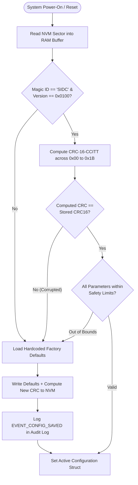

# Non-Volatile Memory (NVM) Configuration Storage

## 1. Storage Layout & Memory Map

Configuration parameters are stored in non-volatile memory (internal MCU flash sector or external I2C EEPROM) using a structured block layout with magic header, schema versioning, and **CRC-16-CCITT** error detection:

```text
Offset  Field Name                  Type        Size (Bytes)   Description
---------------------------------------------------------------------------------------------
0x00    magic_word                  uint32_t    4              Fixed Magic ID: 0x53494443 ("SIDC")
0x04    schema_version              uint16_t    2              Format Version: 0x0100 (v1.0)
0x06    payload_len                 uint16_t    2              Total bytes of configuration
0x08    pre_purge_duration_s        uint16_t    2              Pre-purge duration (seconds)
0x0A    disinfect_duration_s        uint16_t    2              Disinfection duration (seconds)
0x0C    dwell_soak_duration_s       uint16_t    2              Dwell soak duration (seconds)
0x0E    post_purge_duration_s       uint16_t    2              Post-purge duration (seconds)
0x10    target_concentration_ppm    uint16_t    2              Target concentration setpoint
0x12    max_temperature_c           uint16_t    2              Max allowable chamber temp (°C)
0x14    ambient_leak_limit_ppm      uint16_t    2              Room leak trip threshold (PPM)
0x16    min_humidity_rh             uint16_t    2              Minimum humidity (% RH)
0x18    modbus_slave_id             uint8_t     1              Modbus Node Address (1 - 247)
0x19    modbus_baud_idx             uint8_t     1              Baud index (0:9600, 1:19200...)
0x1A    door_interlock_enable       uint8_t     1              Safety door enforcement flag
0x1B    auto_purge_on_fault         uint8_t     1              Run scrubber on emergency trip
0x1C    crc16                       uint16_t    2              CRC-16-CCITT Checksum over 0x00-0x1B
---------------------------------------------------------------------------------------------
Total Block Size: 30 Bytes
```

---

## 2. Integrity Verification & Recovery Algorithm



---

## 3. Flash Wear & Tear Mitigation

1. **Write-on-Change Only:** The configuration manager compares incoming parameter updates against the currently active RAM configuration; if identical, no physical flash erase/write cycles are executed.
2. **Atomic Verification:** Writes are always followed by an immediate read-back and CRC calculation to verify memory integrity before reporting success to the Modbus master.
