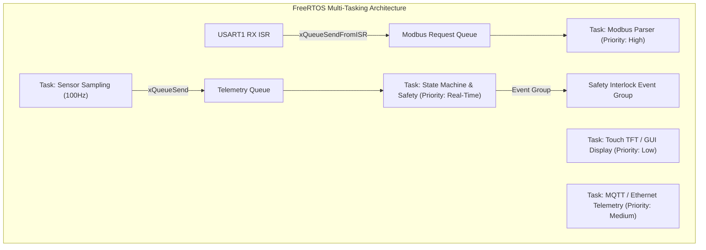

# Key Engineering Decisions & Architectural Tradeoffs

## 1. Architectural Choice: Bare-Metal Cooperative Scheduler vs FreeRTOS

A fundamental design decision in industrial embedded systems is whether to introduce a Real-Time Operating System (RTOS) or utilize a deterministic, event-driven cooperative super-loop.

### Selected Architecture for Base Firmware: Cooperative Multi-Rate Super-Loop

```text
┌────────────────────────────────────────────────────────────────────────┐
│                        Super-Loop Master Cycle                         │
│                                                                        │
│  ┌───────────────────────┐   ┌───────────────────────┐   ┌───────────┐ │
│  │ 1ms: UART / Modbus /  │   │ 10ms: ADC / Filters / │   │ 100ms:    │ │
│  │ E-Stop Fast Scan      │ → │ Switch Debounce       │ → │ FSM Step  │ │
│  └───────────────────────┘   └───────────────────────┘   └───────────┘ │
└────────────────────────────────────────────────────────────────────────┘
```

#### Why Cooperative Super-Loop was Selected:
1. **Deterministic Execution:** No task preemption means zero thread concurrency bugs, zero race conditions on global state structs, and zero priority inversion risks.
2. **Minimal RAM & Flash Footprint:** FreeRTOS requires distinct stack allocations for each task ($512 - 2048$ bytes per stack). The cooperative super-loop uses a single execution stack, reducing SRAM usage to $<4\,\text{KB}$.
3. **Zero Context Switching Overhead:** Context switching on ARM Cortex-M takes $\sim 40 - 80$ CPU cycles. The cooperative multi-rate tick scheduler executes tasks in linear sequence without register stacking overhead.
4. **Safety Verification:** Static timing analysis and full code coverage verification are significantly simpler to certify in mission-critical industrial controllers when tasks run in predictable, non-preemptive slots.

---

### When Would FreeRTOS Become Necessary?

An RTOS becomes advantageous when system complexity scales beyond single-core sequential tasks:



FreeRTOS is strongly recommended if:
1. **Complex Graphical UI (LVGL / TouchGFX):** Rendering high-resolution 320x240 or 480x272 TFT displays involves variable-duration frame drawing routines ($20 - 80\,\text{ms}$) that would block a cooperative super-loop.
2. **Heavy TCP/IP / Cloud Connectivity:** Running an IP stack (LwIP / MQTT / TLS) requires blocking socket calls and asynchronous packet processing best handled in a dedicated networking thread.
3. **Multi-Rate Asynchronous Math:** Complex online model estimation or advanced Kalman filtering requiring variable computation time.

---

## 2. Sensor Digital Filtering: Fixed-Point Exponential Moving Average (EMA)

### Comparison of Filtering Techniques

| Method | Computational Cost | Memory (Bytes) | Transient Noise Rejection | Phase Delay |
| :--- | :---: | :---: | :---: | :---: |
| **Simple Moving Average (SMA)** | Moderate ($N$ adds + div) | $N \times 2$ bytes | Good | Linear with window $N/2$ |
| **Median-3 Filter** | Minimal (3 comparisons) | 6 bytes | **Superior for Spikes / EMI** | Very Low (1 sample) |
| **Fixed-Point EMA (Q8)** | **Lowest (1 mul + 1 shift)** | **4 bytes (State + Alpha)** | **Excellent for High-Freq Noise** | Configurable via $\alpha$ |

### Implemented Strategy: Dual-Stage Filtering
The sensor driver cascades a **Median-3 Filter** (to discard single-sample electrical impulse spikes from relay switching) into an **Integer Q8 Exponential Moving Average Filter** ($\alpha = 20\%$) to achieve smooth analog signals with minimal phase delay and zero floating-point FPU overhead.

---

## 3. Independent Watchdog (IWDG) Strategy

Rather than kicking the watchdog indiscriminately in timer interrupts, the watchdog is serviced exclusively in `process_controller_step_1000ms()`. If any high-priority task hangs, the super-loop halts, the 2-second hardware watchdog window expires, and the microcontroller automatically undergoes a safe hardware reset.
