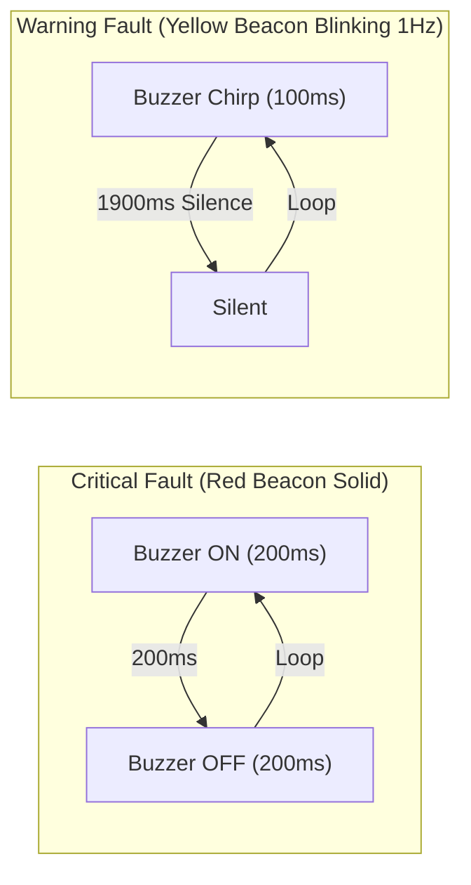

# Industrial Fault Management & Alarm Supervisory

## 1. Fault Code Classification & Severity Matrix

```text
Bit Position  Fault Name                       Severity    Automatic Action Taken
---------------------------------------------------------------------------------------------------------
Bit 0 (0x01)  FAULT_CODE_ESTOP_ACTIVE          CRITICAL    Immediate relay cut, auto-purge ON, red beacon
Bit 1 (0x02)  FAULT_CODE_DOOR_BREACH           CRITICAL    Immediate relay cut, enter EMERGENCY_STOP
Bit 2 (0x04)  FAULT_CODE_TEMP_OVER_LIMIT       CRITICAL    De-energize disinfection relay, enter FAULT_LATCH
Bit 3 (0x08)  FAULT_CODE_AMBIENT_GAS_LEAK      CRITICAL    Immediate shutoff, run exhaust scrubber fan
Bit 4 (0x10)  FAULT_CODE_AIRFLOW_LOST          CRITICAL    Abort pre-purge, latch exhaust blower fault
Bit 5 (0x20)  FAULT_CODE_PROCESS_TIMEOUT       WARNING     Log audit warning, initiate post-purge
Bit 6 (0x40)  FAULT_CODE_NVM_CORRUPTED         WARNING     Auto-restore factory defaults, log event
Bit 7 (0x80)  FAULT_CODE_COMM_TIMEOUT          WARNING     Blink yellow beacon, continue autonomous loop
Bit 8 (0x100) FAULT_CODE_SENSOR_DISCONNECTED   CRITICAL    Abort active cycle, transition to FAULT_LATCH
```

---

## 2. Safety Interlock Trip & Latching Architecture

1. **Deterministic Hardware Isolation:**
   When a critical safety event occurs (e.g. door breach, E-stop press, sensor wire break), `actuator_driver_emergency_all_off()` de-asserts `HAL_GPIO_OUT_DISINFECT_RELAY` in $<10\,\mu\text{s}$.
2. **Latched State Enforcement:**
   Critical faults are permanently latched in `s_fault_state.active_faults`. The state machine remains locked in `STATE_EMERGENCY_STOP` or `STATE_FAULT_LATCH`.
3. **Physical Reset Condition:**
   Calling `alarm_fault_reset_all()` will fail if the underlying hardware contact remains open (e.g. E-Stop button remains physically depressed). Only after physical restoration and explicit operator acknowledge will the fault clear and return the controller to `STATE_READY`.

---

## 3. Visual & Audible Annunciation Patterns


