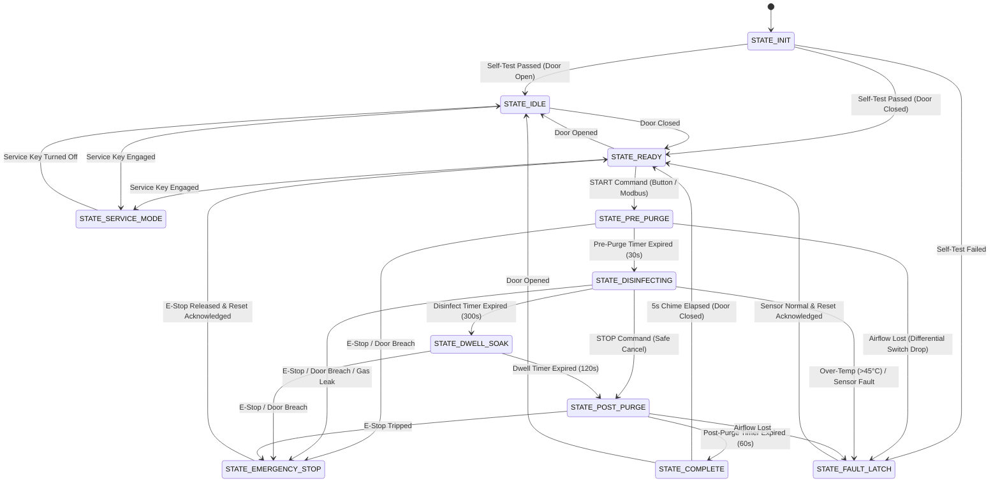

# Finite State Machine (FSM) Specification

## 1. State Definitions

| State ID | Name | Description | Actuator Outputs | Exit Condition / Trigger |
| :--- | :--- | :--- | :--- | :--- |
| `0` | **`STATE_INIT`** | Hardware bring-up, peripheral init, NVM self-test | All Relays OFF | 500ms startup self-test timeout |
| `1` | **`STATE_IDLE`** | Standby mode, Green beacon ON, door unlocked | Green LED ON, All Relays OFF | Door Closed $\rightarrow$ `READY`; Service Key $\rightarrow$ `SERVICE` |
| `2` | **`STATE_READY`** | System interlocks closed, ready for cycle command | Green LED ON, Relays OFF | `START_CMD` $\rightarrow$ `PRE_PURGE`; Door Open $\rightarrow$ `IDLE` |
| `3` | **`STATE_PRE_PURGE`** | Scrubber fan running, differential airflow verified | Scrubber ON, Door Locked, Yellow LED | Pre-Purge duration elapsed (30s) $\rightarrow$ `DISINFECTING` |
| `4` | **`STATE_DISINFECTING`** | Active chemical dispersal / UV-C generation | Disinfect Relay ON, Door Locked, Yellow LED | Disinfect duration elapsed (300s) $\rightarrow$ `DWELL_SOAK` |
| `5` | **`STATE_DWELL_SOAK`** | Sealed contact dwell/soak time | All Relays OFF, Door Locked, Yellow LED | Dwell duration elapsed (120s) $\rightarrow$ `POST_PURGE` |
| `6` | **`STATE_POST_PURGE`** | Active chamber ventilation & chemical scrubbing | Scrubber ON, Door Locked, Yellow LED | Post-Purge duration elapsed (60s) $\rightarrow$ `COMPLETE` |
| `7` | **`STATE_COMPLETE`** | Decontamination successful, audible completion chime | Door Unlocked, Green LED, 5s Chime | 5s chime elapsed or button press $\rightarrow$ `READY` / `IDLE` |
| `8` | **`STATE_WARNING`** | Non-critical advisory condition | Blinking Yellow LED, 2s Chirp | Parameter normalized |
| `9` | **`STATE_FAULT_LATCH`** | Critical sensor fault / hardware error | Red LED Solid, Fast Beep, Scrubber ON | Manual Reset Command + Fault Condition Cleared |
| `10`| **`STATE_EMERGENCY_STOP`**| E-Stop tripped or door opened during active cycle | Red LED Solid, Fast Beep, Scrubber ON | E-Stop Released + Manual Reset Command |
| `11`| **`STATE_SERVICE_MODE`** | Technician manual maintenance & calibration | Relays OFF | Service keyswitch disengaged $\rightarrow$ `IDLE` |

---

## 2. Transition State Diagram

