# System Hardware Architecture & Block Diagram

```mermaid
graph TD
    subgraph SENSORS["Analog & Digital Sensor Inputs"]
        TEMP["Chamber Temp Sensor (0-3.3V)"] -->|ADC1_IN0| MCU["STM32F401 / Cortex-M4 MCU"]
        HUM["Humidity Sensor (0-3.3V)"] -->|ADC1_IN1| MCU
        GAS["Process Concentration (0-3.3V)"] -->|ADC1_IN2| MCU
        LEAK["Ambient Safety Leak Sensor"] -->|ADC1_IN3| MCU
        ESTOP["Emergency Stop (NC Contact)"] -->|GPIOB_PIN1| MCU
        DOOR["Safety Door Interlock (Switch)"] -->|GPIOB_PIN2| MCU
        FLOW["Exhaust Airflow Diff Switch"] -->|GPIOB_PIN11| MCU
        START_SW["Cycle Start Pushbutton"] -->|GPIOC_PIN13| MCU
        STOP_SW["Cycle Stop Pushbutton"] -->|GPIOB_PIN0| MCU
        KEY_SW["Service Keyswitch"] -->|GPIOB_PIN10| MCU
    end

    subgraph ACTUATORS["Power Actuators & Relays (24V / 230V Opto-Isolated)"]
        MCU -->|GPIOA_PIN8| RELAY_DISINFECT["Disinfection Relay / Dispersal Valve"]
        MCU -->|GPIOA_PIN9| RELAY_EXHAUST["Exhaust / Scrubber Blower Fan"]
        MCU -->|GPIOA_PIN10| SOLENOID_DOOR["Electromagnetic Door Lock Solenoid"]
    end

    subgraph INDICATORS["Visual & Audible Safety Beacons"]
        MCU -->|GPIOA_PIN5| LED_GRN["Green Beacon (Idle / Ready)"]
        MCU -->|GPIOA_PIN6| LED_YEL["Yellow Beacon (Active / Dwell)"]
        MCU -->|GPIOA_PIN7| LED_RED["Red Beacon (Fault / E-Stop)"]
        MCU -->|GPIOB_PIN6| BUZZER["Audible Alarm Buzzer"]
    end

    subgraph COMM_MEMORY["Communication & Non-Volatile Memory"]
        MCU <-->|USART1 + DE Pin| RS485["MAX485 Transceiver (Modbus RTU Slave)"]
        MCU <-->|Internal Flash / I2C| NVM["NVM Parameter Store (CRC-16 Protected)"]
        MCU -->|IWDG| WATCHDOG["Hardware Independent Watchdog"]
    end
```

---

## Power & Signal Isolation Topology

1. **Galvanic Isolation:** All relay drivers and opto-coupled digital input circuits are electrically isolated from the 3.3V MCU digital domain using optocouplers (PC817 / TLP281) to suppress electromagnetic transient interference caused by inductive motor and contactor switching.
2. **Safety Interlock Loop:** The Emergency Stop switch (E-Stop) utilizes a dual-path safety architecture: one path directly interrupts the primary 24V/230V relay coil supply rail via a hardware safety relay, while the second path provides a zero-latency digital signal to `GPIOB_PIN1` for firmware state latching and scrubber activation.
